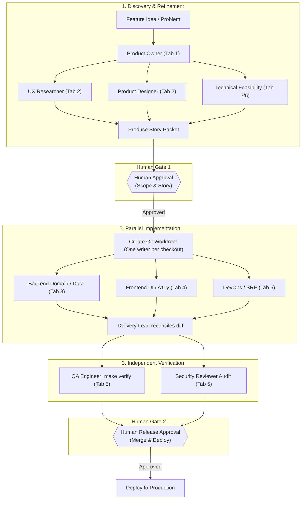

# MyCFC Herdr Team Workspace Guide

This guide describes the AI software development team topology, agent responsibilities, operational boundaries, and collaborative delivery pipeline configured inside the **Herdr** workspace.

---

## 1. Workspace Topology

The Herdr workspace (`mycfc-team`) organizes the development team into six functional tabs, with two specialized panes per tab:

```
┌──────────────────────────────────────────────────────────────────────────────────────┐
│                               WORKSPACE: mycfc-team                                  │
├────────────────────┬────────────────────┬────────────────────┬───────────────────────┤
│ Tab 1: Lead & PO   │ Tab 2: Design & UX │ Tab 3: Backend     │ Tab 4: Frontend       │
├──────────┬─────────┼──────────┬─────────┼──────────┬─────────┼───────────┬───────────┤
│ lead     │ product-│ ux-      │ product-│ backend- │ backend-│ frontend- │ frontend- │
│ (coord)  │ owner   │researcher│ designer│ domain   │ data    │ ui        │ a11y      │
└──────────┴─────────┴──────────┴─────────┴──────────┴─────────┴───────────┴───────────┘
                     ├────────────────────┬────────────────────┤
                     │ Tab 5: QA & Sec    │ Tab 6: Ops & Dev   │
                     ├──────────┬─────────┼──────────┬─────────┤
                     │ qa-      │ security│ devops-  │ runtime-│
                     │ engineer │ reviewer│ sre      │ console │
                     └──────────┴─────────┴──────────┴─────────┘
```

### Tab & Pane Directory (Herdr Desktop App)

| Tab # | Tab Name | Terminal | Pane Role | Primary Function | May Write Code? |
|---|---|---|---|---|---|
| **1** | **Dev** | `t6` | `antigravity` | Primary conversational coding agent / task session | Yes |
| **2** | **Lead & PO** | `t1b` | `lead` | Technical Orchestrator & Delivery Lead | Glue/Integration only |
| **2** | **Lead & PO** | `t1c` | `product-owner` | Product Owner & Discovery Lead | **No** (Read-Only) |
| **3** | **Design & UX** | `t1d` | `ux-researcher` | UX Researcher & Interaction Planner | **No** (Read-Only) |
| **3** | **Design & UX** | `t1f` | `product-designer` | Product Designer & Design Tokens | **No** (Read-Only) |
| **4** | **Backend** | `t1g` | `backend-domain` | Backend Domain & Handler Engineer | **Yes** (Go domain) |
| **4** | **Backend** | `t1h` | `backend-data` | Backend Data, SQL & MinIO Engineer | **Yes** (Schema/Migrations/sqlc) |
| **5** | **Frontend** | `t1j` | `frontend-ui` | Frontend templ & UI Engineer | **Yes** (templ/CSS) |
| **5** | **Frontend** | `t1k` | `frontend-a11y` | Frontend Accessibility Engineer | **Yes** (A11y/Playwright) |
| **6** | **QA & Security** | `t1m` | `qa-engineer` | Independent Quality Engineer | **Tests only** |
| **6** | **QA & Security** | `t1n` | `security-reviewer` | Security & Privacy Reviewer | **No** (Read-Only) |
| **7** | **Ops & Runtime** | `t1p` | `devops-sre` | DevOps & SRE | **Yes** (Terraform/CI) |
| **7** | **Ops & Runtime** | `t1q` | `runtime-console` | Local Runtime & Dev Server Console | Runtime execution |
| **8** | **Prod** | `t12` | `prod.py` | Production health & synthetic check monitor | Read-Only |

---

## 2. Agent Responsibilities & Functional Boundaries

### Tab 1: Delivery Lead & Product Owner

#### `lead` (Delivery Lead & Technical Orchestrator)
- **Primary Function:** Coordinates work across all specialists; breaks tasks into small vertical slices; enforces file-ownership boundaries; reconciles shared contracts; facilitates handoffs.
- **Rules:** Never self-approves scope, merges code, or deploys to production without human authorization.
- **Key References:** `AGENTS.md`, `.agents/skills/mycfc-delivery/SKILL.md`, `docs/agent-team.md`.

#### `product-owner` (Product Owner)
- **Primary Function:** Identifies outcomes, problem statements, actors, non-goals, and observable acceptance criteria. Flags unverified club policies or legal questions for human resolution.
- **Deliverable:** Reviewable **Story Packet** formatted according to `$mycfc-delivery`.
- **Permissions:** Read-Only. Never edits code or creates GitHub issues without human story approval.

---

### Tab 2: Design & User Experience

#### `ux-researcher` (UX Researcher)
- **Primary Function:** Maps user journeys, IA, responsive entry points, and edge states (empty, loading, active, error, success) in the Portuguese (`pt-PT`) member portal context.
- **Key References:** `docs/terminology.md`, `ui/views/`, route specifications.
- **Deliverable:** UX brief, state coverage matrices, usability risks.

#### `product-designer` (Product Designer)
- **Primary Function:** Translates UX flows into visual hierarchy, responsive layouts, design-system tokens, and component state specifications (including forced-colour, zoom, and reduced-motion).
- **Key References:** `docs/design/foundation.md`, `docs/design/visual-direction.md`, `ui/static/src/styles.css`.
- **Deliverable:** Visual specs, layout blueprints, component design briefs.

---

### Tab 3: Backend Engineering

#### `backend-domain` (Backend Domain Engineer)
- **Primary Function:** Implements Go business logic, HTTP handlers, domain services, authorization invariants, transactional boundaries, and unit tests (`go test ./internal/<pkg>`).
- **Key Directories:** `cmd/server/`, `internal/auth/`, `internal/members/`, `internal/events/`, etc.
- **Rules:** Small vertical slices; explicit error handling; never hand-edit generated files.

#### `backend-data` (Backend Data Engineer)
- **Primary Function:** Maintains PostgreSQL baseline (`internal/db/schema.sql`), authors forward-only expand/contract migrations (`internal/db/migrations/`), writes `sqlc` queries (`internal/db/queries/`), manages MinIO storage boundaries, and writes integration tests.
- **Key Commands:** `make generate`, `make test-integration`, `go run ./cmd/server migrate`.
- **Rules:** Never hand-edit `internal/db/generated/*.go`.

---

### Tab 4: Frontend Engineering

#### `frontend-ui` (Frontend UI Engineer)
- **Primary Function:** Implements server-rendered `templ` components (`ui/views/`) and styles/scripts (`ui/static/src/`). Enforces progressive enhancement (functional without JS) and `pt-PT` copy conventions.
- **Key Commands:** `make generate` (compiles templ), `npm run build` (builds fingerprinted assets in `ui/static/dist/`).
- **Rules:** Never hand-edit `*_templ.go` or `ui/static/dist/`.

#### `frontend-a11y` (Frontend Accessibility Engineer)
- **Primary Function:** Guarantees semantic HTML, ARIA conformance, keyboard navigation, focus trapping, and zoom resilience. Authors Playwright and `axe-core` accessibility suites.
- **Key Commands:** `make test-e2e`, `npx playwright test`.
- **Rules:** Never weaken axe findings or test thresholds to bypass failures.

---

### Tab 5: QA & Security

#### `qa-engineer` (Independent Quality Engineer)
- **Primary Function:** Develops risk-based test plans across unit, integration, and e2e tiers. Independently reviews diffs against the acceptance criteria. Executes `make verify`.
- **Permissions:** Test code and fixtures only (`*_test.go`, `scripts/*seed*.sql`). Cannot edit application code without explicit assignment.
- **Rules:** Failing checks are findings, not test bugs to suppress.

#### `security-reviewer` (Security & Privacy Reviewer)
- **Primary Function:** Independent audit of trust boundaries: authentication, sessions, CSRF, guardian authority over minors, medical/contact data privacy, file upload validation, and cloud infrastructure.
- **Deliverable:** Findings report with severity, reproduction logic, affected paths, and mitigations.
- **Permissions:** Read-Only.

---

### Tab 6: Operations & Local Runtime

#### `devops-sre` (DevOps & SRE)
- **Primary Function:** Maintains Terraform infrastructure, Hetzner production bundle, Docker Compose local stack, CI/CD GitHub Actions workflows, observability, and backup/rollback procedures.
- **Safety Rule:** Never modify live production, DNS, or secrets without explicit human authorization.

#### `runtime-console` (Runtime Console)
- **Primary Function:** Live execution environment for local development server (`PATH="$PWD/bin:$PATH" make dev`), migrations, and inspection logs.

---

## 3. How the Team Works Together to Deliver Improvements

Every webapp improvement flows through a disciplined six-stage pipeline:



### Stage 1: Discovery & Story Refinement
1. The user or lead brings a problem/feature to Tab 1 (`product-owner`).
2. `product-owner` refines the outcome and acceptance criteria.
3. If user-facing, `ux-researcher` and `product-designer` (Tab 2) supply the interaction journeys and component specifications.
4. If schema or infra changes are needed, `backend-data` and `devops-sre` assess feasibility.
5. `product-owner` outputs the complete **Story Packet**.

### Stage 2: Human Story Approval Gate
- **PAUSE:** The human product owner must review and approve the Story Packet before any code is written or GitHub issue is opened.

### Stage 3: Parallel Implementation in Isolated Worktrees
- **Rule:** One writer per checkout!
- For independent frontend and backend work, spawn git worktrees using Herdr:
  ```bash
  ./scripts/herdr-team-ctl.sh worktree feature-member-status
  ```
- Backend specialists implement Go handlers, schema migrations, and sqlc queries.
- Frontend specialists build the templ views and Tailwind styles.
- `lead` coordinates shared interfaces and regenerates artifacts (`make generate`, `npm run build`).

### Stage 4: Independent Verification & Security Pass
- `qa-engineer` (Tab 5) reviews the final diff against acceptance criteria and executes:
  ```bash
  make verify
  ```
- If the change touches authentication, minors, personal data, or uploads, `security-reviewer` (Tab 5) conducts an independent audit pass.

### Stage 5: Human Release Gate
- The delivery lead returns the verified diff, test evidence, and release notes to the human.
- Merging and production deployment only occur upon explicit human instruction.

---

## 4. Operational Commands & Cheatsheet

### Herdr Workspace Controls (`./scripts/herdr-team-ctl.sh`)

```bash
# Check team matrix status across all 6 tabs and 12 panes
./scripts/herdr-team-ctl.sh status

# Re-display role briefing cards in all panes (or a specific pane)
./scripts/herdr-team-ctl.sh brief all
./scripts/herdr-team-ctl.sh brief backend-domain

# Execute a command in a specific specialist's pane
./scripts/herdr-team-ctl.sh run backend-domain "go test ./internal/auth -v"
./scripts/herdr-team-ctl.sh run frontend-ui "npm run build"

# Launch the live-reload dev server in runtime-console
./scripts/herdr-team-ctl.sh dev

# Run full repository verification in qa-engineer pane
./scripts/herdr-team-ctl.sh verify

# Create an isolated Git worktree for parallel development
./scripts/herdr-team-ctl.sh worktree feat/member-export
```

### Herdr Keyboard Navigation (Default Prefix: `ctrl+b`)

- **Switch Tabs:** `ctrl+b 1` through `ctrl+b 6`
  - `1`: Lead & PO
  - `2`: Design & UX
  - `3`: Backend
  - `4`: Frontend
  - `5`: QA & Security
  - `6`: Ops & Runtime
- **Navigate Panes:** `ctrl+b h` (left), `ctrl+b l` (right), `ctrl+b j` (down), `ctrl+b k` (up)
- **Toggle Pane Zoom:** `ctrl+b z`
- **Switch Workspaces:** `ctrl+b w`
